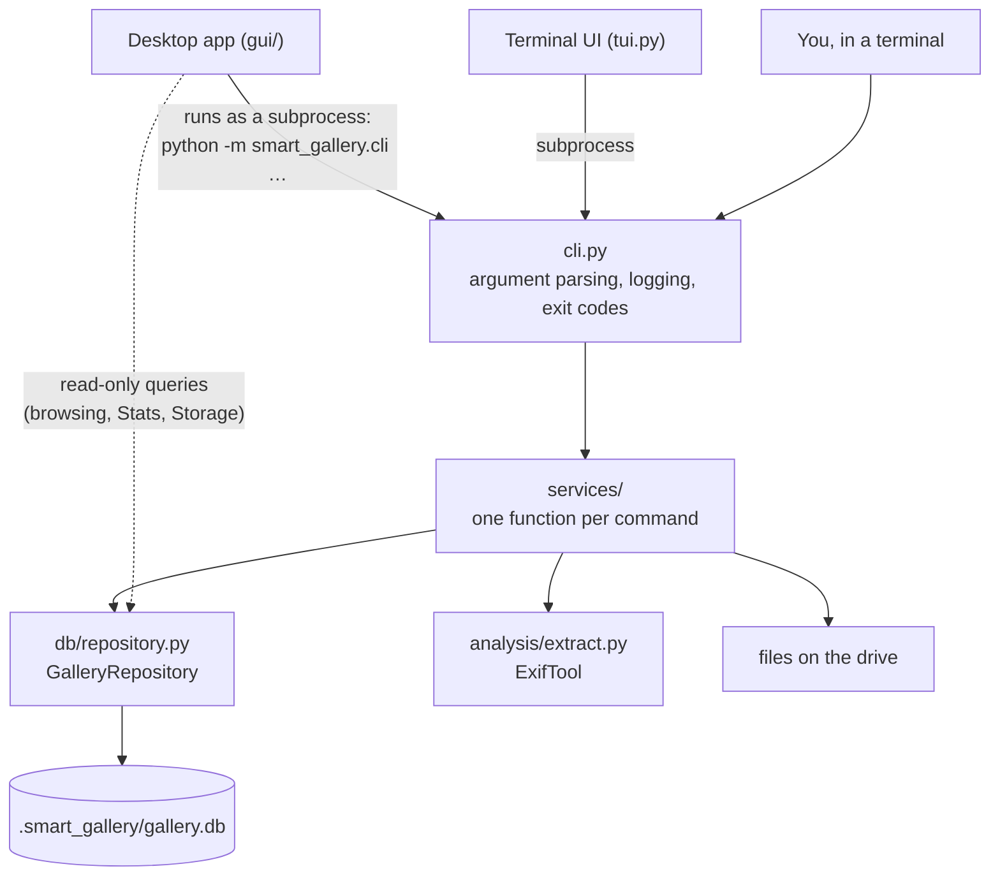

# Smart Gallery — Technical Reference

This document explains **what Smart Gallery does** when it runs: which files it
reads, which steps it takes and in what order, what it writes, what it refuses
to do, and what it prints at the end. It is the companion to the
[User Guide](USER_GUIDE.md), which explains how to use the app. When you are
unsure whether something is safe, or why a command gave the result it did, the
answer should be here.

Every section names the code that implements it (`module.py:function`), so you
can check the behaviour against the source. Paths are relative to the
`smart_gallery/` package.

**Contents**

1. [How the program is put together](#1-how-the-program-is-put-together)
2. [The catalog](#2-the-catalog)
3. [Reading files: classification and metadata](#3-reading-files-classification-and-metadata)
4. [Shared machinery](#4-shared-machinery)
5. [Catalog commands: init, sync, rename](#5-catalog-commands-init-sync-rename)
6. [Import](#6-import)
7. [Export and RAW conversion](#7-export-and-raw-conversion)
8. [Removing files: recycle and raw-to-jpeg](#8-removing-files-recycle-and-raw-to-jpeg)
9. [Mirror drives: pair, sync-mirror, free-up, bring-back](#9-mirror-drives-pair-sync-mirror-free-up-bring-back)
10. [Faces](#10-faces)
11. [Reports and comparisons](#11-reports-and-comparisons)
12. [The desktop app's own mechanics](#12-the-desktop-apps-own-mechanics)
13. [Reference tables](#13-reference-tables)

---

## 1. How the program is put together

Smart Gallery has one engine and three front ends.

- **Every change the desktop app makes goes through the command line.** The
  app starts `smart-gallery <command> …` as a background process (see
  [12.1](#121-jobs-how-the-app-runs-commands)). So a change made in the app
  behaves exactly like the same command typed in a terminal, and the History
  page shows the command that ran.
- The app reads the catalog directly, read-only, to draw the Library, Stats,
  Storage and People pages. It never writes the catalog itself.
- `cli.py` is thin. Each command maps to a handler (`cli.py:_HANDLERS`), which
  opens the catalog, calls a function in `services/`, and logs a summary
  built from the report object that function returns.

---

## 2. The catalog

### 2.1 Where it lives and how a path finds it

A **gallery** is any folder (in practice a drive root such as `E:\`). Its
catalog is the SQLite file `<root>\.smart_gallery\gallery.db`.

Commands accept the drive, any folder inside it, or the `.db` file itself.
`config.py:resolve_db_path` turns the argument into the catalog path:

| You pass | Catalog used |
|---|---|
| A path ending in `.db` | That file |
| Anything else | `<that path>\.smart_gallery\gallery.db` |

So passing a subfolder looks for a catalog *inside that subfolder*, not in the
drive root above it. Pass the root (or the `.db` file).

The root is never stored as the source of truth. It is worked out from where
the catalog file is (`config.py:drive_root_of`): the folder that contains
`.smart_gallery`. That is why a gallery keeps working when the drive gets a
different letter.

### 2.2 Opening the catalog

All access goes through `db/repository.py:GalleryRepository.open`.

| Mode | Used by | What happens |
|---|---|---|
| Read-write | every command that changes something | Opens the file, turns on foreign keys, switches to WAL journaling (falls back to the classic journal on drives that don't support WAL), and **runs migrations** (see 2.5). |
| Read-only | export, report, compare, people, dashboard, the app's pages | Opens with SQLite `mode=ro`. Never migrates, never writes. Readers tolerate tables a newer version added being absent. |
| Create | init | Creates `.smart_gallery\`, creates every table, and stores the catalog's identity (2.3). |

A missing catalog raises *"No catalog at … Run `smart-gallery init` on this
drive first."* and the command exits with code 1.

Every connection waits up to 5 seconds for a lock held by another process
before failing.

### 2.3 Catalog identity (`meta` table)

| Key | Written by | Meaning |
|---|---|---|
| `db_uuid` | init | Random id of this catalog. Mirrors and the app's gallery list find a catalog by it, whatever its drive letter. |
| `drive_root` | init | The root at creation time. Informational only; the live root comes from the file's location. |
| `created_at` | init | Creation time. |
| `hashing_enabled` | init `--hashing` | Recorded; content hashes are otherwise computed only by mirror operations. |
| `drive_label` | init `--label`, rename | The gallery's display name. |
| `schema_version` | init, migrations | See 2.5. |
| `last_sync_at` | sync | Time of the last applied sync. |
| `mirror_face_source` | sync-mirror | On a mirror: which working catalog its face data was copied from. |

### 2.4 Tables

| Table | One row per | Key facts |
|---|---|---|
| `media_items` | file on the drive (plus freed-up files, see 9.4) | `relpath` is unique and compared **case-insensitively**. Columns are listed in [13.2](#132-media_items-columns). |
| `persons` | person or unnamed group | `name` empty = an unnamed group; `hidden` = a hidden group; `centroid` = average face; `reference_centroid` = from `identify-faces` samples. |
| `faces` | detected face | Box, detection score, 512-number embedding, `state`, `person_id`, `suggested_person_id`, `match_score`. Deleted automatically with its media row. |
| `face_scan_state` | scanned image | Detector version, face count, decoded image size. Its absence means "not scanned yet". |
| `face_rejections` | "this face is not that person" | Filing never puts the face back with that person. |
| `face_carryover` | decision waiting for a rescan | See 10.6. |
| `face_undo_*` | correction batch | See 10.5. Last 20 batches kept. |
| `mirror_peers` | paired catalog | Its `db_uuid` and last known path. |
| `mirror_baseline` | file in sync with a mirror | Size and both drives' mtimes at the last sync. |
| `mirror_offloaded` | freed-up file | Which mirror holds it. |

Face data is kept out of `media_items` on purpose. A sync or import rewrites
every column of a media row; keeping faces in their own tables means a sync
can never wipe them.

`mirror_*` tables have no foreign key to `media_items`: a baseline row has to
outlive a deleted media row, because that is how "deleted on the working
drive" is recognised.

### 2.5 Schema versions and migration

`config.SCHEMA_VERSION` is the version this program expects (currently **8**).
Each read-write open runs `db/schema.py:migrate`, which applies every step
newer than the catalog's stored version:

| Version | Adds |
|---|---|
| 2 | Face tables (`persons`, `faces`, `face_scan_state`). |
| 3 | `persons.reference_centroid`. |
| 4 | Clears impossible dates (`0000-00-00`) written by older versions. |
| 5 | Face `state`, suggestions, `hidden` persons, rejections, carry-over. Existing faces of named people become `auto`, of unnamed groups `cluster`. |
| 6 | Indexes for suggestion counts and rejections. |
| 7 | Mirror tables. |
| 8 | Face undo tables. |

Every step is "create if missing", so running it twice changes nothing.
Read-only opens never migrate: an old catalog opened read-only stays at its
old version until a command writes to it.

### 2.6 How a change to a file is detected

Only two numbers are compared: the file's **size** and its **modification time
in nanoseconds** (`mtime_ns`). If both match the catalog, the file is treated
as unchanged and is not read again. Content hashes are not used for this.

Consequences:

- Editing a photo in another program changes its mtime, so the next sync
  re-reads it.
- A tool that rewrites a file and then restores its old size and mtime would
  go unnoticed. Normal editors don't do this.

---

## 3. Reading files: classification and metadata

### 3.1 Classification

`config.py:classify` decides by extension (case-insensitive):

| Type | Extensions |
|---|---|
| `image` | `.jpg .jpeg .png .webp .cr2 .cr3` |
| `video` | `.mp4 .mov .avi .mkv .m4v .3gp .gif` |
| `other` | everything else |

RAW support is for **Canon `.CR3` and `.CR2`**. Other makers' RAW files
(`.NEF`, `.ARW`, `.RAF`, `.DNG` …) are `other`: catalogued with name, folder
and size only, no metadata, no thumbnail, no faces.

### 3.2 Which files are walked

`config.py:iter_files` walks the folder tree and skips:

- folders named `.smart_gallery`, `$RECYCLE.BIN`, `System Volume Information`,
  `FOUND.000`, `.Trash`, `@eaDir` (case-insensitive);
- files ending in `.sg-partial` (an unfinished copy, see 4.4).

So the catalog, its thumbnails, the trash folder and the staging folders are
never catalogued.

### 3.3 ExifTool

Metadata comes from ExifTool (`analysis/extract.py`). Images and videos are
read in separate passes, each split into batches run in parallel:

| Files to read | Batch size | Parallel ExifTool processes |
|---|---|---|
| under 10,000 | files ÷ workers (at least 250 per worker) | up to 8 (and up to the CPU count) |
| 10,000–29,999 | 2,500 | up to 6 |
| 30,000 and more | 3,000 | up to 3 |

`SG_EXIFTOOL_MAX_WORKERS` lowers the worker cap; `SG_EXIFTOOL_BATCH_SIZE`
sets the batch size (minimum 100).

Each batch runs `exiftool -j -n -fast -m -q -q -c %.6f` (images use `-fast2`)
over an argument file listing the paths, asking only for the tags below.
`-n` returns raw numbers (an aperture of `2.8`, an exposure of `0.004`)
instead of formatted text.

Files of type `other` are never given to ExifTool; their row is built from
the file system alone.

If ExifTool is not installed the command stops with *"ExifTool not found.
Install it and ensure 'exiftool' is on PATH."* A batch that fails for another
reason is logged and its files are left out of the result; the rest of the
run continues.

### 3.4 From tags to catalog columns

`models.py:MediaItem.from_exiftool`:

| Column | Images | Videos |
|---|---|---|
| `date_taken`, `time_taken`, `taken_ts` | `DateTimeOriginal`, else `CreateDate` | same |
| `camera` | `Model` | — |
| `lens` | `LensModel`, else `LensID` | — |
| `focal_length` | `FocalLength` (mm) | — |
| `aperture` | `FNumber`, else `Aperture` | — |
| `iso` | `ISO` | — |
| `shutter_speed_sec` | `ExposureTime` (seconds) | — |
| `shutter_speed_text` | formatted from it, e.g. `1/250` | — |
| `latitude`, `longitude`, `altitude` | `GPSLatitude`, `GPSLongitude`, `GPSAltitude` | — |
| `width`, `height` | `ImageWidth`/`ImageHeight` (else the `ExifImage…` tags) | `ImageWidth`/`ImageHeight` |
| `duration_ms` | — | `Duration` × 1000 |
| `codec` | — | `VideoCodecID`, else `CompressorID` |
| `frame_rate` | — | `VideoFrameRate` |
| `size_bytes` | `FileSize` | same |
| `mtime_ns`, `relpath`, `directory_rel` | from the file system | same |

**Dates.** `2026:06:28 14:30:00` becomes `date_taken = 2026-06-28`,
`time_taken = 14:30:00`, and `taken_ts` = that moment as seconds since 1970
**in the computer's local time zone** (camera dates carry no zone). An
impossible date such as `0000:00:00`, which a camera writes when its clock was
never set, is stored as no date at all. A file without a date is still
catalogued; it just has no `date_taken` and is left out by any date filter.

---

## 4. Shared machinery

### 4.1 Exit codes

`cli.py:main`:

| Code | Meaning |
|---|---|
| 0 | Finished. Some commands still list skipped or failed files in the log; see each command. |
| 1 | Refused or failed: a missing catalog or file, an existing catalog, invalid input, a refused mirror operation, an unexpected error. The reason is the last error line. `sync-mirror` also exits 1 when any file failed. |
| 130 | Cancelled. Work finished before the stop is kept. |

### 4.2 Logs

Everything at INFO level and above goes to the terminal. For long-running
commands (`init`, `import`, `sync`, `export`, `scan-faces`, `file-faces`,
`label-faces`, `undo-faces`, `find-faces`, `recycle`, `raw-to-jpeg`,
`sync-mirror`, `free-up`, `bring-back`) everything, including one DEBUG line
per file (`Copied: …`, `Skipped (already exists): …`, `Freed up: …`), is also
written to `logs\<command>-<YYYY-MM-DD_HH-MM-SS>.log` under the **current
folder**. The run ends with a `Details: <path>` line naming that file.

When the desktop app runs a command, the current folder is the app's data
folder (12.7), so its logs are in `%LOCALAPPDATA%\SmartGallery\logs\`.

### 4.3 Progress and cancelling

Long operations report progress as named steps (`progress.py`): *Finding
files*, *Comparing files*, *Reading metadata*, *Copying files*, *Scanning
faces*, *Sorting faces*, *Moving files to Recycle Bin*, *Freeing up space*,
*Converting to JPEG*. Copy-like steps also count outcomes (copied / skipped /
failed).

- In a terminal they draw a progress bar.
- With `SG_PROGRESS=json` (set by the desktop app and the terminal UI) each
  event is printed as a line `@sg-progress {"step": …, "done": …, "total": …,
  "outcomes": [[name, n], …], "unit": …}` for the front end to draw.

**Cancelling.** The app sets `SG_CANCEL_FILE` to a path. Creating that file
asks the command to stop. Commands check at every progress event, between
copy chunks (every 8 MB), and once a second while waiting on ExifTool. On a
stop the command finishes or undoes the file it is on, writes what is done to
the catalog, and exits with code 130.

### 4.4 How files are copied

Every copy goes through `organize/organize.py:copy_atomic`:

1. Copy into `<destination>.sg-partial`, 8 MB at a time.
2. Copy the source's timestamps onto it.
3. Rename it to the final name.

If anything fails or the run is cancelled, the partial file is deleted. A
destination is therefore either complete or absent; a truncated photo can't
be left behind. Mirror copies (`mirror` service `_copy`) additionally refuse
to overwrite an existing file and set the copy's mtime to the source's exactly.

### 4.5 Where removed files go

Smart Gallery never deletes a file permanently, with **one deliberate
exception** (free-up, 9.4).

| Removed by | Goes to | Kept for |
|---|---|---|
| `recycle`, `raw-to-jpeg`, the Storage page | The Windows Recycle Bin | Until you empty it |
| `sync-mirror` (deleted or replaced files, on either drive) | `<root>\.smart_gallery\trash\<YYYYMMDD-HHMMSS>\<relpath>` | 30 days; older folders are purged at the end of each sync-mirror |
| `free-up` | **Deleted** from the working drive only after its verified copy on the mirror is confirmed | — |

The Recycle Bin is only used on fixed local drives with the Recycle Bin turned
on (`recycle_bin.py:supports_recycle_bin`). Otherwise the command refuses to
start and moves nothing. A file larger than the drive's Recycle Bin limit is
reported as failed, not deleted.

### 4.6 Filters

The same filters (`organize/filters.py:FilterOptions`) are used by the
Library, Stats, export, report, import and free-up. All active filters must
match (AND); several values within one filter match any of them (OR).

| Filter | A file matches when |
|---|---|
| File types | its type is one of those listed |
| Extensions | its extension is one of those listed (`JPG` and `.jpg` both work) |
| Date range | it has a date taken, within the range, both ends inclusive |
| Cameras / Lenses | its camera / lens is exactly one of those listed |
| Aperture, ISO, Shutter | it has that value and it is within the range (inclusive) |
| People (*any*) | it has a face assigned to any of the people |
| People (*all*) | it has faces assigned to every one of the people |

Any camera, lens, aperture, ISO or shutter filter also limits the result to
**photos**, since videos and other files have none of those values.

A face counts for the People filter when the face's person is that person,
whatever its state (`user`, `auto` or `cluster`); a face only *suggested* for
someone does not count.

Filtering happens in SQL for files already in a catalog (`db/where.py`) and
in memory for files not catalogued yet (`matches()`, used by import). A test
keeps the two in agreement. The People filter exists only in SQL, so import
can't filter by person.

---

## 5. Catalog commands: init, sync, rename

### 5.1 `init <drive> [--label NAME] [--overwrite]`

`services/init_db.py:init_drive`

1. If a catalog exists: refuse (*"A catalog already exists … Use
   --overwrite …, or run `sync`"*), exit 1. With `--overwrite` the old
   catalog file is deleted first; **its face data and mirror pairing go with
   it**.
2. Create the catalog and its identity (2.3).
3. Walk the drive (3.2), read every image and video with ExifTool (3.3), and
   insert one row per file.

**Output:** `Initialized <catalog> with N items.`
**On cancel:** the half-made catalog (and its `-wal`/`-shm` files) is
deleted, so the command can simply be run again.

### 5.2 `sync <drive> [--dry-run]`

`services/sync.py:sync_drive`. Brings the catalog in line with the drive.

1. Walk the drive and `stat` each file (size, mtime). No file is opened.
2. Compare with the catalog:
   - **added**: on the drive, not in the catalog;
   - **updated**: in both, size or mtime differ;
   - **deleted**: in the catalog, not on the drive (except freed-up files,
     which are meant to be absent, 9.4);
   - **unchanged**: everything else.
3. Log `Sync plan — add=… update=… delete=… unchanged=…`. With `--dry-run`,
   stop here.
4. Read only the added and updated files with ExifTool.
5. In **one transaction**: delete the rows of deleted files, insert or
   rewrite the rows of added and updated files, record `last_sync_at`.
6. Updated files: their faces are cleared so the next face scan re-reads
   them; your face decisions are saved for the rescan (10.6).
7. Deleted files: their faces, scan state and rejections are removed with the
   row.

**Freed-up files that come back.** If a freed-up file reappears with the
catalog row's exact size and mtime (it was copied back), its freed-up flag is
cleared. If a *different* file appears at that path, the row and flag are left
untouched and a warning is logged, so the next mirror sync can't mistake it
for an edit and overwrite the mirror's only copy.

**Output:**
`Sync — +added ~updated -deleted =unchanged`, then, if any photos have
never been scanned for faces, `N image(s) pending face scan — run
smart-gallery find-faces.`

### 5.3 `rename <drive> <name>`

`services/rename.py:rename_gallery`. Trims the name and folds runs of spaces.
Refuses a blank name or one over 80 characters. Writes `drive_label`. The
name is in the catalog, so it travels with the drive.

---

## 6. Import

`import <drive> <sources…> [--output DIR] [--structure Year Month …]
[--no-by-media-type] [--on-exist rename|skip] [filters] [--no-mirror]
[--dry-run]` — `services/import_media.py:import_media`

Copies files from a card or folder onto the drive, files them into dated
folders, and adds them to the catalog. **Sources are only read; nothing is
ever moved or deleted from them.**

### 6.1 Steps

1. **Gather sources.** Folders are walked like a drive (3.2), so a source that
   is itself a gallery never imports its `.smart_gallery` folder.
2. **Read** every source file with ExifTool (once; the values are reused for
   the catalog row).
3. **Filter** in memory with the import's filters (4.6).
4. **Split off offloaded-on-arrival files** (only with a mirror, see 6.4).
5. **Place** each remaining file (6.2) with an atomic copy (4.4).
6. **Catalog** every placed file. The row keeps the metadata read from the
   source; path, size and mtime come from the copy.
7. **Copy to mirrors** (6.3), unless `--no-mirror`.

If cancelled during step 5, what was copied so far is catalogued and the
command exits 130; mirrors catch up at the next sync-mirror.

### 6.2 Where a file goes

`organize/organize.py:target_dir_for`. Starting from `--output` (default: the
drive root):

1. Photos go under `Photos\`, videos under `Videos\` (turn off with
   `--no-by-media-type`). Other files go straight under the output folder.
2. Then one folder per `--structure` part, in order. Parts are `Year`,
   `Month` (two digits), `Model` (camera) and `Lens`. Default: `Year Month`.
3. If a part has no value, the file goes into a `No Info` folder at that
   point and the remaining parts are dropped. A file with no date, camera or
   lens at all goes to `No Info` directly. Videos use only `Year` and `Month`.
   Other files always go to `No Info`.

Example: a photo taken 2024-05-12 → `Photos\2024\05\IMG_0001.JPG`.

**Name clashes.** A destination counts as taken when a file exists there,
when the catalog already has a row at that path (for example a freed-up
file), or when this same import already chose it.

- `--on-exist rename` (default): the copy becomes `IMG_0001_1.JPG`,
  `IMG_0001_2.JPG`, …
- `--on-exist skip`: the file is not copied. If a file is present at that
  path, its catalog row is refreshed from the source's metadata and it is
  counted as *skipped*. Re-importing the same card with `skip` is therefore
  safe and copies only new files.

### 6.3 Mirrors during import

If the gallery is paired as a working drive (9.1), each mirror that can be
found (9.2) and that confirms the pairing gets a copy of every placed file,
**read from the working-drive copy**, at the same relative path.

- A different file already at that path on the mirror is never overwritten;
  it is counted as *pending* for that mirror.
- The same file already there (same size and mtime) is accepted as is.
- Each mirror copy gets a catalog row on the mirror (with no content hash)
  and a baseline row, so the next sync-mirror knows they match.
- A mirror that is missing or fails never undoes the import; its files stay
  *pending* until the next sync-mirror.

### 6.4 Offloaded on arrival

If you have freed up space with a rule (9.4), new files that match the same
rule are **not** kept on the working drive. They are copied from the source
straight to each mirror and get a freed-up row on the working drive. If no
mirror received a file, it is copied to the working drive after all.

### 6.5 Output

`Imported: copied=… skipped=… inserted=…`, then per mirror
`Mirror <uuid>: N file(s) copied, M pending.` Files that could not be read or
placed are logged as errors and counted as *excluded* (part of `failed` in the
progress counts).

### 6.6 Import profiles (desktop app)

The app's import profiles (`import_profiles.py`) are saved as JSON in
`%LOCALAPPDATA%\SmartGallery\profiles\`. A profile is a list of rules (file
type, extensions, output folder, extra options). Running it expands into one
`import` command per rule per chosen gallery, run one after another as one
job.

---

## 7. Export and RAW conversion

### 7.1 `export <drive> <dest> [filters] [--structure …] [--mirror] [--on-exist …] [--jpeg-only] [--portable-db] [--no-manifest] [--dry-run]`

`services/export.py:export_media`. Opens the catalog **read-only** and never
re-reads metadata: everything comes from the catalog.

1. Select the matching rows (4.6).
2. Choose each destination:
   - `--mirror`: the same relative path as on the drive;
   - otherwise the import layout (6.2) under `<dest>`.
3. Copy each file atomically. A file missing from the drive is logged as
   *"Missing on the drive, not exported"* and counted as excluded. Clashes
   follow `--on-exist` as in import; a skipped file is still listed in the
   manifest.
4. Unless `--no-manifest`: write `<dest>\_smart_gallery_manifest.csv` with
   `relpath, media_type, date_taken, camera, lens, size_bytes` for every
   exported file (copied or skipped).
5. With `--portable-db`: create a new catalog at `<dest>` describing the
   exported files, so the export can be opened as a gallery of its own.

**JPEG only (`--jpeg-only`)**:

| Matched file | Result |
|---|---|
| `.jpg` / `.jpeg`, any video | Copied as is |
| `.cr2` / `.cr3` with **no** same-named JPEG in the same folder among the matches | Converted to `<name>.jpg` |
| `.cr2` / `.cr3` **with** such a JPEG | Left out (that JPEG is exported instead) |
| Anything else (PNG, other files) | Left out |

Plain copies run first, then RAWs in batches of 50, so a converted RAW never
takes the name of a JPEG copied as is. Each RAW is copied into
`<dest>\.smart_gallery_raw_staging\`, converted there with 7.2, and the JPEG
is moved into place; the staging folder is deleted at the end. **The source
drive is never written.**

**Output:** `Exported C of M matched files to <dest>.` (with `--jpeg-only`
also `N RAW file(s) converted to JPEG; K other file(s) left out.`). If
cancelled, the manifest and portable catalog are still written for what was
exported, then the command exits 130.

### 7.2 `convert-raw <sources…>` (alias `convert-cr3`)

`services/convert_cr3.py:convert_cr3`. Writes the full-size JPEG the camera
stored inside each Canon RAW file, **beside the RAW**, as `<name>.jpg`.

1. Find `.cr2`/`.cr3` files (folders are searched recursively).
2. Skip a RAW that already has `<name>.jpg` or `<name>.jpeg` beside it.
3. Extract `JpgFromRaw` (where CR3 files keep it) with one ExifTool run; for
   any RAW that produced nothing, try `PreviewImage` (where CR2 files keep it).
4. Copy **all** metadata from the RAW into the new JPEG (orientation, date,
   camera, lens, exposure, GPS); without this a portrait photo would show
   sideways and lose its date.

It does not touch any catalog: run `sync` afterwards to add the JPEGs.

**Output:** `Converted N RAW file(s); skipped S with an existing JPEG; failed F.`
Each failure is logged with ExifTool's reason.

---

## 8. Removing files: recycle and raw-to-jpeg

The Storage page's *Move files to Recycle Bin* and *RAW → JPEG* buttons write
a list file and run these commands with `--list`. Both delete the list
afterwards (unless the command was refused before starting), because running
the same list again after restoring files could remove them twice.

### 8.1 List format

UTF-8 text, one file per line: `relpath<TAB>size_bytes<TAB>mtime_ns`. Only
LF or CRLF end a line.

### 8.2 `recycle <drive> --list FILE`

`services/recycle.py:recycle_files`

A listed file is moved only if **all** of these hold, else it is *skipped*
with the reason logged:

| Check | Skip reason |
|---|---|
| It is in the catalog | not in the catalog |
| The catalog's size and mtime equal the list's | the catalog has a different size or date |
| The list gives an mtime | no modification time to check |
| Its real path is inside the drive root | outside the drive |
| It exists | file is missing |
| It is a regular file (not a link or folder) | not a regular file |
| Its size and mtime on disk equal the list's | file changed on disk |

Then it goes to the Recycle Bin (4.5) and its catalog row is deleted **in its
own commit**, so the catalog matches the disk even if the run stops halfway.
Its faces are deleted with the row.

**Output:** `Moved N file(s) to the Recycle Bin, freeing X; S skipped, F failed.`

On a paired working drive, the removed files are recognised as deleted at the
next sync-mirror and moved to the mirror's trash.

### 8.3 `raw-to-jpeg <drive> --list FILE`

`services/raw_to_jpeg.py:replace_raws`. Replaces each listed **CR3** with its
camera JPEG, keeping the photo's faces.

**Refused before touching anything** when the gallery is a mirror, or the
drive has no Recycle Bin.

Per batch of 10 photos:

1. **Check** each entry as in 8.2, plus: it must be a `.cr3`; no `<name>.jpg`
   or `<name>.jpeg` may exist beside it; the catalog must not already have
   `<name>.JPG`; it must fit in the Recycle Bin.
2. **Extract** the embedded `JpgFromRaw` into
   `.smart_gallery\staging\id<catalog id>-<name>.JPG` (the walk never visits
   this folder).
3. **Copy metadata** from the CR3 and set the JPEG's mtime to the CR3's.
4. **Validate** the staged JPEG: not empty, decodes completely, is a JPEG,
   has exactly the CR3's pixel size, and has the CR3's orientation.
5. **Replace**, one photo at a time:
   1. move the staged JPEG beside the CR3 as `<name>.JPG` (never over an
      existing file);
   2. in one transaction: add the JPEG's row, move the CR3's faces to it
      (boxes rotated when needed, see below), delete the CR3's row (and its
      `.xmp` sidecar's row);
   3. move the CR3 (and its `.xmp`) to the Recycle Bin;
   4. commit.

   Any failure before step 4 rolls back the transaction and deletes the new
   JPEG, leaving the CR3 and its row exactly as they were.

**Face boxes.** Faces are stored in the frame the scanner saw. The scanner
saw the CR3's embedded preview with that preview's own orientation applied.
If the preview had no orientation tag, the boxes are rotated by the CR3's
orientation; a photo whose face boxes don't fit either frame is failed with
*"face frame mismatch"* rather than guessed. Cached face thumbnails of moved
faces are deleted and re-cut from the JPEG when next shown.

**If the catalog can't be saved after the CR3 went to the Recycle Bin** the
command stops with an error explaining how to recover: restore the CR3 from
the Recycle Bin, delete the new JPEG, and run raw-to-jpeg again. Do **not**
run sync first: it would drop the CR3's row and its faces.

**If the process is killed outright**, the next run clears the staging
folder. At most one photo can be left half-done: its JPEG beside the CR3
with the CR3 already in the Recycle Bin.

**Output:** `Converted N CR3(s) to JPEG, freeing X and moving F face(s); S
skipped, K failed.` *Freeing* counts the CR3s and sidecars recycled minus the
JPEGs written.

---

## 9. Mirror drives: pair, sync-mirror, free-up, bring-back

A **working** drive (E) is where you work. A **mirror** (D) is a copy that
sync keeps in step. **Sync only goes E → D.** Files are compared by relative
path, case-insensitively.

### 9.1 `pair <working> <mirror>`

`services/mirror.py:pair_galleries`. Refuses when:

- both are the same catalog;
- the working gallery is itself a mirror;
- the mirror is a working gallery;
- the mirror is already paired with a different working drive.

Writes a `mirror_peers` row on each side with the other's `db_uuid` and
current path. A working drive may have several mirrors; a mirror has one
working drive. No file is copied: the first sync-mirror does that.

### 9.2 Finding the other drive

`mirror/peers.py:find_peer`. The stored path is tried first and accepted only
if the catalog there has the expected `db_uuid`. Otherwise the same path is
tried under every other drive letter. A drive that moved from `D:` to `F:` is
therefore found without re-pairing.

With several mirrors, commands need `--mirror <drive or .db>` to choose one.

### 9.3 `sync-mirror <working> [--mirror M] [--dry-run] [--plan-out F] [--expect-plan F] [choices]`

`services/mirror.py:plan_mirror_sync` and `apply_mirror_sync`

**Refusals** (nothing happens, exit 1):

| Condition | Message (abridged) |
|---|---|
| Run on the mirror | Run sync-mirror on the working drive. |
| Not paired / roles wrong / not each other's peer | These galleries are not paired … |
| Either root missing | The working/mirror drive … is not available. |
| The working drive has no files | … may be unmounted or empty. Refusing to plan. |
| The sync would trash more than **5%** of the mirror's files and `--confirm-large-delete` was not given | This sync would move N of M mirror files to the trash … |
| The mirror lacks space for the copies | The mirror has N bytes free but this sync copies M bytes. |
| `--expect-plan` given and the drives changed since that preview | The drives changed since the preview … Nothing was synced. |

#### Planning

1. `sync` both drives (5.2), so both catalogs describe the disks.
2. Load each catalog's rows, the **baseline** (each file's size and both
   drives' mtimes at the last successful sync), and the freed-up list.
3. Hash files where needed (below).
4. Classify every path (`mirror/plan.py:build_plan`).

**"Changed" is decided per drive**: a file changed on E if its size or mtime
differs from E's mtime in the baseline, and on D likewise. Mtimes are never
compared *across* drives to decide a change, because exFAT and daylight-saving
shifts make them unreliable between drives.

**"Same file" across drives** means the same size and either the same mtime
or the same content hash. Hashes (BLAKE2b, 20 bytes) are computed only for
the files that need this comparison, as one counted step, and stored in
`content_hash`.

| Class | Situation | What apply does |
|---|---|---|
| `copy_new` | On E, not on D | Copy E → D |
| `overwrite` | Changed on E since the baseline, not on D | D's copy to D's trash, then copy E → D |
| `trash` | In the baseline, deleted from E, unchanged on D | D's copy to D's trash |
| `moves` | A `trash` file and a `copy_new` file with the same size and hash | Rename on D (no copy) |
| `adopt` | Same file on both but not in the baseline (or both changed identically) | Record in the baseline only |
| `only_on_mirror` | On D, not on E, never in the baseline | Your choice (below); default leave |
| `changed_on_mirror` | Changed on D only; or deleted on E but edited on D | Your choice; default skip. **Never trashed automatically.** |
| `conflicts` | Changed on both, different content; or on both without a baseline and different | Your choice; default skip |
| `offloaded_changed` | A freed-up file whose mirror copy changed | Listed only |
| `offloaded_missing` | A freed-up file no longer on the mirror that held it | Listed with a warning: **the only copy may be gone** |
| `offloaded_conflict` | A freed-up path where E now has a different file | Listed with a warning; that file is not mirrored until moved |

Choices:

| Option | Values |
|---|---|
| `--only-on-mirror` | `later` (default): leave; `keep-on-mirror`: add to E's catalog as freed-up; `copy-back`: copy D → E |
| `--changed-on-mirror` | `skip` (default); `take-working`: E's version (or E's deletion) wins; `keep-mirror`: copy D's version to E |
| `--conflicts` | same as above |

With `--dry-run` the plan is logged (and written with `--plan-out`) and
nothing else happens.

**`--plan-out FILE`** writes JSON: `counts` (per class), one list of relpaths
per class (`moves` as `[old, new]` pairs), `copy_bytes`,
`mirror_free_bytes`, `mirror_trash_bytes`, `trash_bytes`, `large_delete`.

**`--expect-plan FILE`** makes the real run re-plan and refuse if any trash,
overwrite, move, or chosen action is not in that file. New copies are allowed,
because they only add files. The desktop app always runs a dry run first,
shows it, and passes it here.

#### Applying

Operations run in this order: moves, trashes, overwrites, new copies, then
your choices for changed and conflicting files, then only-on-mirror files.

- "Delete" always means a move into that drive's trash (4.5). If a replacing
  copy fails, the trashed original is put back.
- A file that fails is logged (`Mirror sync failed for …`) and the run
  continues; the command exits 1 at the end if any failed.
- Catalog rows and baseline rows for finished files are written in batches
  of 200, **catalogs first, baseline last**. If the run stops in between, the
  next plan simply re-adopts the file.
- A file copied to the other drive gets the source catalog's row (no
  ExifTool) without a content hash: a hash describes the bytes it was read
  from.
- When E's file is replaced from D, E's faces for it are cleared for rescan.

After the files:

1. Baseline rows for paths in neither catalog are dropped, so a later D-only
   file at that path is asked about instead of trashed.
2. **Face data is copied** E → D (`mirror/faces.py:sync_face_data`) in one
   transaction: persons and faces keep their ids; faces are matched to D's
   media rows by relative path; scan state, rejections and carry-over are
   replaced. If D's faces came from a different working catalog, they are
   wiped first. Cached face thumbnails on D that no longer match are deleted.
3. Trash folders older than 30 days are purged on both drives.

**Output:** the plan line `Plan: copy_new=…, trash=…; copy X, to trash Y
(mirror free Z, already in its trash W).`, then `Mirror sync: copied=…
overwritten=… trashed=… moved=… copied_back=… skipped=…`, then one error line
per failed file.

### 9.4 `free-up <working> [filters] [--folder PATH …] [--dry-run] [--plan-out F] [--expect-plan F]`

`services/mirror.py:free_up_space`. **The only permanent delete.** Removes
files from the working drive whose verified copy is on the mirror. The
mirror's files are never changed.

**Selection** must be by file type, extension, date range and/or folder.
Other filters (camera, people …) are refused, because the selection is saved
as a rule (below). An empty selection is refused.

1. `sync` both drives.
2. Candidates: selected files not already freed up. With `--expect-plan`,
   only files listed in that preview's `relpaths` are considered; others are
   skipped as *not in the previewed list*.
3. **Verify** each candidate. Both copies are **re-hashed from disk**, ignoring
   stored hashes, because this check guards a permanent delete. Skip reasons:
   - *no verified copy on mirror*: not on the mirror, different size, or
     different hash;
   - *faces not scanned*: a photo not yet scanned at the current detector
     version, because its faces could never be found afterwards.
4. With `--dry-run`: report what would be freed and stop.
5. Copy face data to the mirror (as in 9.3), then confirm every photo's scan
   state is now on the mirror; any that isn't is skipped.
6. For each file, immediately before deleting it: re-check its size and mtime
   (skip as *changed on the working drive* if they moved) and the mirror
   copy's size. Then **flag it as freed up first, delete it second**. A kill
   between the two leaves a flag on a file that is still there, which the
   next sync clears; the other order could make the mirror's copy look
   deleted on E and get it trashed.
7. If anything was freed by a type/extension/date selection (not by folder),
   the selection is saved as an **offload rule**: new matching imports go
   straight to the mirror (6.4).

**What remains on E** for a freed-up file: its catalog row (shown greyed out
in the Library), its faces, and the freed-up flag naming the mirror that
holds it. Freed-up photos are not face-scan candidates.

**Output:** one `Skipped: <relpath>: <reason>` line per skipped file, then
`Freed N file(s), X.` (`Would free` for a dry run). `--plan-out` writes
`files`, `bytes`, `relpaths` and `skipped`.

### 9.5 `bring-back <working> [filters] [--folder PATH …]`

`services/mirror.py:bring_back`

1. Candidates: selected files that are freed up **to this mirror**.
2. A file not found on the mirror is skipped (*not on the mirror*).
3. Refuse if the working drive lacks space for all of them.
4. Copy each D → E (never over an existing file), keeping the mtime.
5. Write their rows from the mirror's catalog, clear their freed-up flags,
   add baseline rows. A file whose content differs from what was freed up
   has its faces cleared for rescan.
6. If the selection equals a saved offload rule, that rule is removed.

**Output:** `Brought back N file(s), X.` and one `Skipped:` line per file not
brought back.

---

## 10. Faces

Faces are found and sorted **only on the working drive**. Every face command
refuses on a mirror (*"This gallery is a mirror; run face commands on the
working drive."*); mirrors receive a copy through sync-mirror.

### 10.1 Face states

| State | Set by | Meaning | Changed by later filing? |
|---|---|---|---|
| `user` | you (confirm, move, new person) | You said this face is this person | **Never** |
| `ignored` | you (ignore), hiding a group | Not to be shown or sorted | **Never** |
| `auto` | filing | Confidently matched to a **named** person | Only if rejected from it, or a different named person now fits clearly better |
| `cluster` | filing | Member of an **unnamed** group | Same as `auto` |
| `suggested` | filing | Possibly a named person; awaiting your answer (`suggested_person_id`) | Yes |
| `hidden` | filing | Too small or blurry, or a one-off stranger | Stays hidden; only `cluster-faces --rebuild` reconsiders |
| `new` | scan, rejection, deletion | Not sorted | Yes |

### 10.2 `scan-faces <drive> [--rescan] [--limit N]`

`services/scan_faces.py:scan_faces` with `analysis/faces.py:FaceScanner`.
Needs the `faces` extra.

**What is scanned:** every photo (`image`) not yet scanned at the current
detector version (`buffalo_l@scrfd10g_r50`), except freed-up files. Already
scanned photos are skipped, so the command can be stopped and run again and
continues where it left off. `--rescan` first clears all faces and scan
states (your decisions are saved for carry-over, 10.6; unnamed, unhidden
groups are dropped).

**Model:** InsightFace `buffalo_l` (SCRFD detector, ArcFace embedding)
through ONNX Runtime. It prefers the GPU (CUDA) and logs a warning if it fell
back to the CPU, which is many times slower. `SG_FACES_REQUIRE_GPU=1` makes a
CPU fallback an error.

**Per photo:**

1. Decode on a CPU thread pool (up to 8 threads). JPEG/PNG/WebP are decoded
   normally; **CR2/CR3 use their embedded JPEG preview**, which is much faster
   than developing the RAW and good enough for detection.
2. Detect and embed on one GPU thread. A face is kept if its detection score
   is at least 0.5 and the shorter side of its box at least 24 pixels.
3. Save a 160-pixel thumbnail of each face to
   `.smart_gallery\faces\<id÷1000>\<id>.jpg`.
4. Every 500 photos, in one transaction: replace the photo's faces, record
   its scan state (face count, decoded size), and re-apply saved decisions
   (10.6).

**A photo that can't be decoded** is marked scanned with 0 faces so it isn't
retried on every run, but its existing faces and saved decisions are kept for
a later successful scan.

**Output:** `Scanned N images — F faces (provider=…), C decisions carried
over, D dropped.`

### 10.3 `file-faces <drive> [--no-group]`

`services/file_faces.py:file_faces` with `analysis/filing.py:decide`. No GPU.

**Inputs.** Every face whose state is not `user` or `ignored`, and every
person as a candidate:

| Candidate | Its examples |
|---|---|
| Named person | Your confirmed (`user`) faces of them, plus their sample reference (10.8). Only if neither exists: their centroid. |
| Unnamed group | Its centroid |
| Hidden group | Its centroid |

**Score.** Embeddings have length 1, so a dot product is the cosine
similarity (−1 to 1). A face's score for a candidate is the **mean of its 5
highest similarities** to that candidate's examples (fewer if there are fewer
examples). A candidate is **not allowed** for a face if you rejected the face
from it, or if the face is closer to one of the faces rejected from that
candidate than to any of its examples.

**Rules, in order** (`filing.py:_rules`, defaults in `FilingConfig`):

1. A `hidden` face stays hidden.
2. An `auto` or `cluster` face keeps its person, unless you have since ruled
   it out of that person. Exception: if a *different named* person scores
   **≥ 0.50** and at least **0.05** above its current person, it moves there
   as `auto`.
3. **Quality gate:** a face whose box's shorter side is under **40 px** or
   whose detection score is under **0.60** becomes `hidden`.
4. No allowed candidate → `new`.
5. Best allowed score **≥ 0.50** and at least **0.05** above the runner-up →
   `auto` (named person), `cluster` (unnamed group) or `hidden` (hidden group).
6. Otherwise, the best allowed named person scoring **≥ 0.35** → `suggested`
   for that person.
7. Otherwise → `new`.

**Grouping** (unless `--no-group`). If at least 3 faces end up `new`, they are
clustered with HDBSCAN (minimum group size 3). Each cluster of 3 or more
becomes a new unnamed group (`cluster` faces); faces left out of every
cluster become `hidden`. Then every face is filed once more so the new groups
are taken into account.

All decisions are written in one transaction, then each touched person's
centroid (normalised mean of its faces), face count and cover face (highest
detection score) are recomputed. An unnamed, unhidden person left with no
faces is deleted.

**Output:** `Sorted faces: A matched, S suggested, G grouped into N new
group(s), H hidden, L left.`

### 10.4 `find-faces <drive>`

`scan-faces` then `file-faces` (with grouping). The People page's *Find new
faces* runs this. Output combines both summaries.

### 10.5 Corrections: `label-faces` and `undo-faces`

`services/label_faces.py:label_faces`

One correction on the command line (`--faces ID… --to P | --new-person NAME |
--not P | --confirm P | --ignore`) or a JSON list (`--list FILE`, written by
the app: `[{"action": …, "faces": […], "person_id": …, "name": …}, …]`).
Everything is validated before anything is written, and all corrections are
applied in **one transaction**.

| Action | Effect on each face |
|---|---|
| `confirm P` | Becomes `user` of P; any rejection of it from P is removed |
| `move P` | Same as confirm; if it was assigned to someone else, it is also marked *not* them |
| `new_person NAME` | Move to the person with that name (case-insensitive), creating them if needed |
| `reject P` (`--not`) | Recorded as not P. If it was assigned or suggested to P it becomes `new` |
| `ignore` | Becomes `ignored`, unassigned |

A person id that doesn't exist is an error, except in `--list` mode, where
corrections for people deleted meanwhile are skipped and counted. Face ids
that no longer exist are counted as missing. With `--refile`, filing (10.3,
without grouping) runs right after, so the rest of the faces react to the
correction.

Each run is saved as an **undo batch** recording every face's state, person,
suggestion and score before and after, plus the rejections and persons it
added or removed. Including the refile. The last 20 batches are kept.

**`undo-faces <drive>`** restores the newest batch. It refuses (*"Can't undo
… N of its faces changed since. Nothing was changed."*) if anything it would
restore has changed since, for example a rescan replaced the faces, or a
person it would point to was deleted. `--forget` drops the newest batch
without changing any face.

### 10.6 Decisions survive a rescan (carry-over)

Whenever a photo's faces are about to be replaced (sync found the file
changed, `--rescan`, a detector version change, a file replaced during
mirror sync), these are saved to `face_carryover` first:

- `user` and `ignored` faces;
- `auto` and `cluster` faces of **named** people (saved as `auto`);
- rejections.

When the photo is scanned again, each saved decision goes to the new face
whose box overlaps it most, with an overlap (intersection over union) of at
least **0.5**, boxes compared relative to image size. Where a user decision
and an automatic one compete, the user decision wins. Decisions that find no
matching face are dropped and counted (*decisions dropped*).

### 10.7 People commands

| Command | Effect |
|---|---|
| `people <drive> [--samples N]` | Read-only list: id, name, hidden flag, face count, and clickable sample photos. |
| `name-person <drive> ID [NAME]` | Names a person, or clears the name if NAME is omitted. Naming turns the group's `cluster` faces into `auto`. If another person already has that name (case-insensitive) it refuses, unless `--merge`, which merges ID into them. |
| `merge-persons <drive> DEST SRC…` | Moves all faces, suggestions and rejections of SRC to DEST and deletes SRC. A face you filed in SRC overrides an old rejection of it by DEST. An unnamed DEST takes the name of its only named source. DEST's `cluster` faces become `auto` if DEST is named. |
| `split-person <drive> ID` | Re-clusters ID's non-`user` faces with stricter settings (HDBSCAN, min size 3). The sub-group closest to your confirmed faces (or the largest) stays; every other sub-group becomes a new unnamed group whose faces are marked *not ID*. ID itself is never deleted. |
| `hide-person <drive> ID [--unhide]` | Only for unnamed groups. Hiding makes its faces `ignored`; unhiding puts its ignored/hidden faces back to `cluster`. |
| `delete-person <drive> ID` | Deletes the person. Its faces become `new` and unassigned; faces merely suggested for it lose the suggestion. Rejections naming it are deleted. |
| `cluster-faces <drive> [--rebuild] [--incremental]` | Runs filing (10.3). `--rebuild` first returns every undecided face to the pool and drops unnamed groups (named people, hidden groups and your decisions stay). `--incremental` files into existing people only, without new groups. The old clustering knobs are accepted but ignored. |

### 10.8 `identify-faces <drive> --samples DIR`

`services/identify_faces.py`. An optional shortcut for naming people from
example photos.

1. `DIR` holds one folder per person, named after them. Each photo in it
   must contain **exactly one** face; others are skipped with a warning.
2. Each person's reference is the normalised mean of their sample faces.
   It is stored as the person's `reference_centroid` (the person is created
   if no one has that name; two existing people with the name is an error).
3. Faces you have not decided are assigned to the best-matching reference
   when the similarity is ≥ `--threshold` (0.5) and beats the runner-up by
   `--margin` (0.05), never to a person they were rejected from.
   `--reassign` first releases the `auto` faces of these people.

**Output:** `Identified N face(s) across P people; U unmatched, A ambiguous,
K already assigned. Usable samples: …; skipped: ….`

---

## 11. Reports and comparisons

### 11.1 `report <drive> <file.xlsx> [filters] [--figures]`

`reporting/excel.py`. Read-only. Writes a workbook with three sheets,
`images`, `videos` and `others`, one row per matching file, with a clickable
full path, an autofilter and a frozen header row. `--figures` also writes
charts to a `Figures` folder beside the workbook (needs the `figures`
extra; a failure there is logged and does not affect the workbook).

### 11.2 `compare <A> <B> [--match-by path|name|hash] [--format text|csv|json] [--details] [--output F]`

`services/compare.py:compare_galleries`. Opens both catalogs read-only and
pairs their rows:

| `--match-by` | Key |
|---|---|
| `path` (default) | relative path, case-insensitive |
| `name` | file name only |
| `hash` | content hash (refused if a catalog has none stored) |

| Status | Meaning |
|---|---|
| `only_a` / `only_b` | Key found in one catalog only |
| `changed` | Paired; at least one catalog column other than the path differs (listed with `--details`) |
| `unchanged` | Paired; all columns equal |
| `ambiguous` | Key occurs more than once in a catalog; not paired |
| `unmatched_a` / `unmatched_b` | No key (no hash in hash mode) |

It compares catalog data, not files: run `sync` on both first for an
up-to-date answer.

### 11.3 `dashboard <drive>`

Starts the Streamlit dashboard (`streamlit run dashboard/app.py`) with the
catalog path in `SG_DB_PATH`. Read-only.

---

## 12. The desktop app's own mechanics

### 12.1 Jobs: how the app runs commands

`gui/jobs.py:JobRunner`. One job at a time. A job is one or more CLI command
lines run in order (an import profile, for example).

- Each runs as `python -m smart_gallery.cli …` (or `smart-gallery.exe` in the
  installed app) with `SG_PROGRESS=json`, `SG_CANCEL_FILE=<…\jobs\<id>.stop>`,
  UTF-8 output, and the app's data folder as current folder.
- The next command line starts only if the previous one exited 0.
- **Cancel** creates the stop file (4.3) and waits up to **2 minutes** for the
  command to stop on its own. Cancelling again, or the wait running out,
  kills the process tree (`taskkill /T /F`, so ExifTool children die too).
- The last log line becomes the job's summary; a `Details:` line gives the
  log path.
- When it ends, a record is appended to `history.jsonl`: title, command
  lines, start/end time, status (`ok`, `failed` or `cancelled` — exit 130 or
  a cancel request), exit code, summary, log path and the last 200 output
  lines. The History page shows these. *Run again* opens an import job on the
  Import page (drive letters may have changed), opens a single command in the
  Advanced form to check and run, and re-runs a multi-step job after asking.
- A job that changes the catalog makes every page reload.

### 12.2 Gallery list

`gui/galleries/store.py`. The galleries you opened are kept in
`galleries.json` (id, catalog path, name) with the last one opened. A
gallery whose path no longer exists is looked for under every drive letter
by its `db_uuid`, like a mirror (9.2).

### 12.3 Thumbnails and previews

`gui/thumbs/cache.py`. Thumbnails (256 px) are cached on the gallery's drive
at `.smart_gallery\thumbs\<id÷1000>\<id>-<mtime_ns>.jpg`; the mtime in the
name makes an edited file get a fresh thumbnail. A `.none` marker records a
file that couldn't be thumbnailed, so it isn't retried.

| File | Source of the picture |
|---|---|
| JPEG/PNG/WebP | The image itself |
| CR2/CR3 | The embedded preview (`PreviewImage`, else `JpgFromRaw`, else `ThumbnailImage`), via ExifTool |
| Video | A typical frame chosen by ffmpeg if installed, else the embedded thumbnail |
| Other | No thumbnail (grey placeholder) |

The viewer uses the same sources at a larger size.

### 12.4 The Storage page

All analyses read only the catalog; nothing on disk is read except by the
picture check.

- **Size trees** (`storage/tree.py`): totals by folder and by file type from
  `size_bytes`.
- **RAW + JPEG pairs** (`storage/pairs.py`): a `.cr2`/`.cr3` and a
  `.jpg`/`.jpeg` with the same name in the same folder (case-insensitive).
  Your choice per pair (keep RAW, JPEG or both) is turned into the list of
  files to recycle; a *keep* always wins over a removal. A RAW's `.xmp`
  sidecar goes only when every RAW sharing it goes.
- **Picture check** (`storage/compare.py`): extracts each RAW's embedded
  preview and compares it with the JPEG, both shrunk to 32×32 greyscale.
  *Match* when the aspect ratios are within 2% and the correlation is at
  least 0.90; *different* otherwise; *unreadable* when either can't be
  opened. Verdicts are remembered in a JSON cache keyed by both files' paths,
  sizes and mtimes.
- **Bursts** (`storage/bursts.py`): photos in the same folder by the same
  camera, each taken within *gap* seconds (default 2, 1–10) of the previous
  one, with the whole run spanning at most 10 seconds. One *shot* is every
  file sharing a name in a folder (CR3 + JPG …) plus its sidecar. Runs of 2
  or more shots are bursts. Files whose name ends in `-edited` and freed-up
  files are left out. You can't mark every shot of a burst.
- **RAW → JPEG** (`storage/raw_jpeg.py`): CR3 files with no `.jpg`, `.jpeg`
  or `.heic` of the same name beside them, not freed up. The estimated saving
  assumes each JPEG is about 5% of its CR3.

Removals run as `recycle` (8.2); conversions as `raw-to-jpeg` (8.3).

### 12.5 The People page

Reads faces and persons directly for display. Every change is sent as one
`label-faces --list <file> --refile` job per batch of corrections (10.5);
*Undo* runs `undo-faces`. *Find more* ranks unclassified faces by their
score for the person (10.3) without writing anything; confirming or
rejecting them is again a `label-faces` job.

### 12.6 Mirror menu (Sync options)

Each action runs its dry run first with `--plan-out` to a file under the
app's `mirror\` folder, shows the result, and only then runs the real
command with `--expect-plan` pointing at that file (9.3, 9.4).

### 12.7 App data folder

`%LOCALAPPDATA%\SmartGallery\` (or `SG_APP_DATA` if set):

| Path | Contents |
|---|---|
| `galleries.json` | Gallery list (12.2) |
| `history.jsonl` | Job history (12.1) |
| `logs\` | Detailed logs of app-run commands (4.2) |
| `jobs\` | Stop files of running jobs |
| `mirror\` | Sync and free-up previews (`--plan-out` files) |
| `profiles\` | Import profiles (6.6) |

---

## 13. Reference tables

### 13.1 Files Smart Gallery creates on a gallery's drive

| Path | Created by | Safe to delete? |
|---|---|---|
| `.smart_gallery\gallery.db` (+ `-wal`, `-shm`) | init | **No** — this is the catalog |
| `.smart_gallery\thumbs\` | the app | Yes; rebuilt when needed |
| `.smart_gallery\faces\` | scan-faces | Yes; face thumbnails are re-cut when shown |
| `.smart_gallery\trash\<stamp>\` | sync-mirror | Yes, if you don't need those files; purged after 30 days anyway |
| `.smart_gallery\staging\` | raw-to-jpeg | Yes when no job runs; cleared at the next run |
| `*.sg-partial` | an interrupted copy | Yes |

### 13.2 `media_items` columns

`id`, `relpath`, `media_type`, `name` (file name without extension), `ext`
(lower case, with dot), `directory_rel`, `size_bytes`, `mtime_ns`,
`content_hash`, `date_taken` (`YYYY-MM-DD`), `time_taken` (`HH:MM:SS`),
`taken_ts`, `camera`, `lens`, `focal_length`, `aperture`, `iso`,
`shutter_speed_text`, `shutter_speed_sec`, `latitude`, `longitude`,
`altitude`, `width`, `height`, `duration_ms`, `codec`, `frame_rate`,
`created_at`, `updated_at`.

### 13.3 Environment variables

| Variable | Effect |
|---|---|
| `SG_EXIFTOOL_MAX_WORKERS` | Cap on parallel ExifTool processes |
| `SG_EXIFTOOL_BATCH_SIZE` | Files per ExifTool process (min 100) |
| `SG_PROGRESS=json` | Progress as `@sg-progress` JSON lines |
| `SG_CANCEL_FILE` | Path whose creation stops the command |
| `SG_APP_DATA` | Desktop app data folder |
| `SG_DB_PATH` | Catalog the dashboard opens |
| `SG_FACES_PROVIDERS` | ONNX Runtime providers, comma-separated (default CUDA then CPU) |
| `SG_FACES_REQUIRE_GPU=1` | Fail instead of scanning on the CPU |
| `SG_FACES_DET_SIZE` | Detector input size in pixels (default 640) |
| `SG_FACES_CTX_ID` | GPU index (default 0) |
| `SG_FACES_MIN_SCORE` | Minimum detection score kept by the scan (default 0.5) |
| `SG_FACES_MIN_PX` | Minimum face size kept by the scan (default 24 px) |
| `SG_FACES_DECODE_WORKERS` | Image-decoding threads during a scan (default CPU count − 1, max 8) |

### 13.4 Thresholds and limits at a glance

| Value | Where | Default |
|---|---|---|
| Large-delete guard | sync-mirror | more than 5% of the mirror's files |
| Trash retention | sync-mirror | 30 days |
| Baseline write batch | sync-mirror | 200 files |
| Copy chunk / cancel check | all copies | 8 MB |
| raw-to-jpeg batch | raw-to-jpeg | 10 photos |
| Export RAW batch | export `--jpeg-only` | 50 RAWs |
| Scan commit | scan-faces | 500 photos |
| Auto match | filing | ≥ 0.50 and 0.05 ahead |
| Suggestion | filing | ≥ 0.35 |
| Hidden by quality | filing | short side < 40 px or score < 0.60 |
| Minimum new group | filing | 3 faces |
| Carry-over overlap | rescan | IoU ≥ 0.5 |
| Undo history | label-faces | 20 batches |
| Job cancel grace | desktop app | 2 minutes |
| Gallery name | rename | 80 characters |
