# Smart Gallery — User Guide

This guide is for someone who has never used Smart Gallery. It starts with
what the program is and how to install it, walks through a first session,
then explains every page of the desktop app and the jobs behind it. The last
chapters cover the command line, where data is kept, and what to do when
something goes wrong.

The screenshots come from a small demo library. Your folders and photos will
look different, but the controls are the same.

**Contents**

1. [What Smart Gallery is](#1-what-smart-gallery-is)
2. [Installing](#2-installing)
3. [Your first session](#3-your-first-session)
4. [The app window](#4-the-app-window)
5. [Galleries](#5-galleries)
6. [Library: browsing and finding photos](#6-library-browsing-and-finding-photos)
7. [Import and Export: bringing photos in and out](#7-import-and-export-bringing-photos-in-and-out)
8. [Keeping the catalog up to date](#8-keeping-the-catalog-up-to-date)
9. [Stats](#9-stats)
10. [Storage: where the space goes](#10-storage-where-the-space-goes)
11. [People: finding photos by who is in them](#11-people-finding-photos-by-who-is-in-them)
12. [Two drives: a working copy and a mirror](#12-two-drives-a-working-copy-and-a-mirror)
13. [Actions and History: jobs](#13-actions-and-history-jobs)
14. [The command line](#14-the-command-line)
15. [Where your data lives](#15-where-your-data-lives)
16. [Troubleshooting and questions](#16-troubleshooting-and-questions)
17. [Glossary](#17-glossary)

---

## 1. What Smart Gallery is

Smart Gallery is a catalog for a large photo and video collection kept on a
drive (an external disk, an internal disk, or any folder). It reads the
information stored inside each file (date taken, camera, lens, exposure, GPS
position) and keeps it in a small database **on the same drive**. You then
browse, filter, count and copy your photos using that database, without
re-reading thousands of files every time.

It does **not** move your files into a hidden library or change them. Your
photos stay in normal folders you can open in File Explorer. Smart Gallery
only writes files when you ask it to (an import, an export, a mirror sync,
freeing up space), and anything it removes goes to a recycle bin or a trash
folder first.

### The gallery and its catalog

A **gallery** is a drive or folder that Smart Gallery manages. Its **catalog**
is the database file `.smart_gallery/gallery.db` inside that folder.

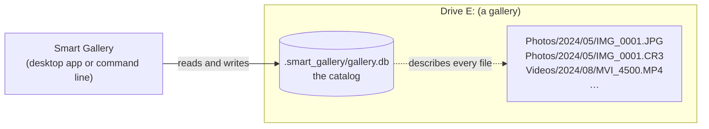

Because the catalog travels with the drive, you can plug the drive into
another computer, or get a different drive letter, and the gallery still
works.

### What you can do with it

| Task | Where |
|---|---|
| Browse photos by folder, date, camera, lens, exposure | [Library](#6-library-browsing-and-finding-photos) |
| Copy new photos from an SD card into dated folders | [Import](#7-import-and-export-bringing-photos-in-and-out) |
| See charts of how and when you shoot | [Stats](#9-stats) |
| Find what takes up space; drop duplicate RAW or JPEG copies | [Storage](#10-storage-where-the-space-goes) |
| Group photos by person (face recognition) | [People](#11-people-finding-photos-by-who-is-in-them) |
| Keep a second drive as an identical backup | [Mirror](#12-two-drives-a-working-copy-and-a-mirror) |
| Copy a selection out (optionally with RAW photos as JPEGs) | [Export](#export) |
| Write an Excel report, compare catalogs | [Actions](#13-actions-and-history-jobs) |

---

## 2. Installing

### What you need

- **Windows** (the desktop app is built for Windows; the command line also
  runs elsewhere).
- **[ExifTool](https://exiftool.org/)**, the free program Smart Gallery uses to
  read photo information. Install it and make sure `exiftool` runs from a
  command prompt. Without it, the app shows a warning bar and cannot read new
  files.
- Optional, for face recognition: an **NVIDIA graphics card** with a recent
  driver (see [section 11](#11-people-finding-photos-by-who-is-in-them)).

### Option A: the installer

If someone built the installer for you, run `SmartGallery-Setup-<version>.exe`.
It installs for your user only (no administrator rights needed), adds
**Smart Gallery** to the Start menu, and registers an uninstaller. Start the
app from the Start menu.

### Option B: from the source code

With [Python 3.13+](https://www.python.org/) and
[uv](https://docs.astral.sh/uv/) installed, in the project folder:

```bash
uv sync --extra gui          # add --extra faces for face recognition
uv run smart-gallery gui     # opens the desktop app
```

To build the installer yourself, see "Installing the desktop app" in the
[README](../README.md#installing-the-desktop-app).

---

## 3. Your first session

This is the shortest path from nothing to browsing your photos.

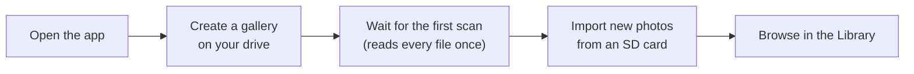

1. **Open Smart Gallery.** The first time, no gallery is open.
2. **Create a gallery.** Click the gallery button at the top left (it says
   *No gallery*) and choose **Create on drive…**. Pick the drive or folder that
   holds your photos, for example `E:\`. The app starts a job that walks the
   whole drive and records every file. On a large drive this takes a while;
   the bar at the bottom of the window shows progress, and you can keep
   using the app.
3. **Name it** (optional). In the same menu, **Rename gallery…** gives it a
   friendly name such as *Family Photos*. The name is stored on the drive.
4. **Browse.** When the scan finishes, the **Library** page shows your
   folders on the left and the photos on the right.
5. **Import new photos.** Put an SD card in, open the **Import / Export** page, pick
   the card as the source, tick your gallery, and press **Run import**
   ([section 7](#7-import-and-export-bringing-photos-in-and-out)).

> **Already have a gallery?** If the drive already has a
> `.smart_gallery` folder (made on another computer, or by an earlier
> version), use **Add existing…** instead of *Create on drive…*.

---

## 4. The app window

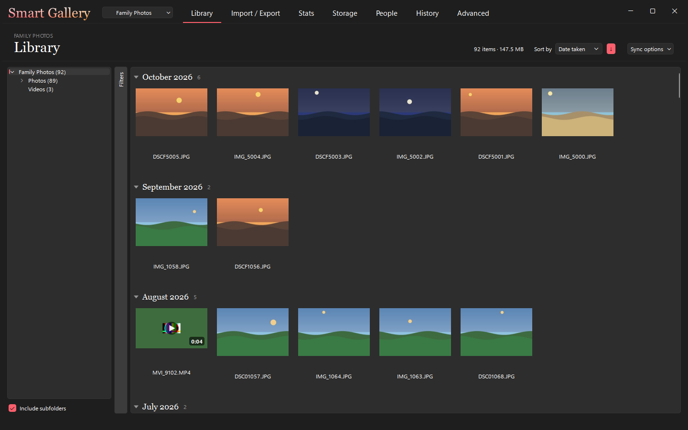

From top to bottom:

- **Top bar.** The *Smart Gallery* name, the **gallery button** (which
  gallery is open; click it to switch, add or create one), then one **tab per
  page**: Library, Import / Export, Stats, Storage, People, Actions, History. The
  buttons at the far right minimise, maximise and close the window. Drag the
  top bar to move the window; double-click it to maximise.
- **Page header.** The open gallery's name in small capitals, the page title,
  and on the right the page's own controls (in the Library: item count,
  **Mirror**, **Filters**, **Sort by**).
- **The page** itself.
- **Status bar** at the bottom. While a job runs it shows the job's title,
  its current step, live counts and a **Cancel** button. When nothing runs it
  shows how the last job ended (*Last job: ok*).

### Jobs

Everything that changes a catalog or copies files runs as a **job** in the
background: creating a gallery, importing, syncing, finding faces, moving
files to the Recycle Bin, and so on. Only **one job runs at a time**; if you
start another, the app tells you a job is already running.

- **Cancel** asks the job to stop after the file it is working on, so nothing
  is left half-copied. If it does not stop, click again (**Force stop**) to
  end it at once.
- Every job is recorded on the [History page](#13-actions-and-history-jobs)
  with its log, and can be run again from there.
- If you close the window while a job runs, the app asks whether to cancel it
  first.

---

## 5. Galleries

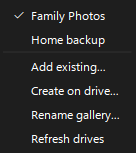

The gallery button lists every gallery the app knows, with a dot next to the
open one. Below the list:

| Command | What it does |
|---|---|
| **Add existing…** | Open a drive or folder that already has a catalog. |
| **Create on drive…** | Make a new catalog on a drive or folder and scan it (a job). |
| **Rename gallery…** | Give the open gallery a new name. The name is stored in the catalog, so it follows the drive to any computer. |
| **Refresh drives** | Look again for drives plugged in or removed. A gallery whose drive came back under another letter is found again automatically. |

If two galleries have the same name, the menu shows each one's drive after
the name, for example `Archive (D:)`.

A gallery whose drive is unplugged stays in the list. Its pages show *Drive
not connected* until you plug the drive back in and choose **Refresh
drives**.

---

## 6. Library: browsing and finding photos

The Library is where you spend most of your time.

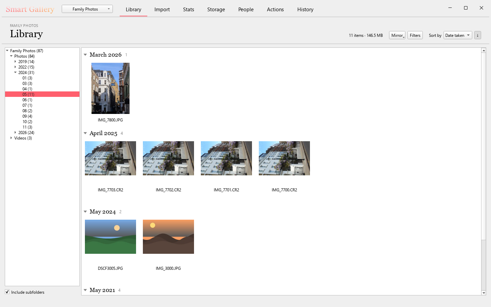

### The folder tree (left)

The tree shows the gallery's folders with the number of items in each, for
example `2024 (31)`. Click a folder to show its items. With **Include
subfolders** ticked (at the bottom), a folder also shows everything inside its
subfolders; untick it to see only the files directly in that folder.

### The grid (right)

Each tile is one file, with a thumbnail and its name. Thumbnails are made in
the background the first time you see them and kept, so scrolling is fast
afterwards. Tiles are grouped under headings that follow the sort order:
by month for *Date taken*, by folder for *Name*, by size band for *Size*.
Click a heading's triangle to fold a group; right-click a heading for
**Collapse all** and **Expand all**.

**Sort by** chooses *Date taken*, *Name* or *Size*; the arrow button next to
it flips between newest/largest first and oldest/smallest first.

The header shows how many items are on screen and their total size (for
example *87 items · 159.6 MB*).

### Viewing a photo

Double-click a tile to open the **viewer**: a large preview beside a card
with the file's information (path, date taken, camera, lens, focal length,
aperture, ISO, shutter, dimensions, duration for videos, and size).
Use the **Left** and **Right** arrow keys to step through the items on
screen. **Show in Explorer** opens the file's folder with the file selected.

<!-- SCREENSHOT TO ADD: images/viewer.png — the viewer window with a real photo and its info card. -->
> *Screenshot to add: the viewer window.*

### Filters

Press **Filters** in the header to show or hide the filter panel.

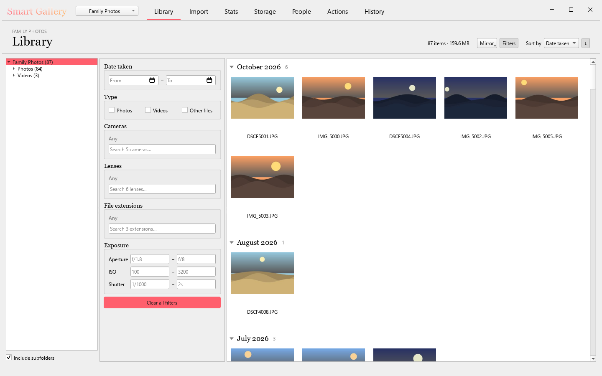

| Filter | Meaning |
|---|---|
| **Date taken** | Only items taken between two dates (either end can be left empty). |
| **Type** | Photos, Videos, Other files. None ticked means all. |
| **Cameras**, **Lenses** | Tick one or more; the search box narrows long lists. |
| **File extensions** | For example only `.CR3`, or only `.JPG`. |
| **Exposure** | Aperture, ISO and shutter-speed ranges. |
| **People** | (with face recognition) photos with *any* or *all* of the chosen people. |

All active filters apply together: *Canon EOS R6* **and** *2024* **and**
*ISO 1600 or more*. A camera, lens or exposure filter leaves out videos and
other files, because they have no such values. **Clear all filters** resets
everything. The **Stats** page uses the same filters, so a filter you set in
the Library also shapes the charts.

### Greyed-out items

Faded tiles with grey names are photos whose file is **not on this drive**
any more: they were moved to a mirror drive to free up space
([section 12](#12-two-drives-a-working-copy-and-a-mirror)). They stay in the
catalog, with their faces and information, so you can still find and count
them. Hover over one to see which drive keeps it.

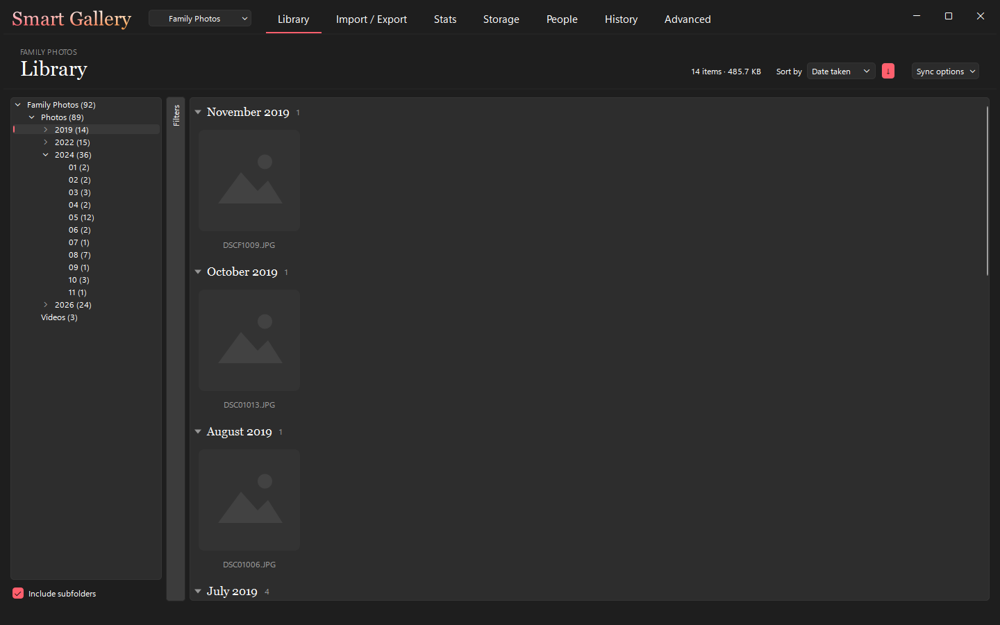

---

## 7. Import and Export: bringing photos in and out

The **Import / Export** page has a switch at the top right: **Import** brings
photos into a gallery, **Export** copies a selection out of it.

### Import

Import copies photos and videos **from** a source (an SD card, a phone dump,
any folder) **into** one or more galleries, sorted into dated folders, and adds
them to the catalog. It only copies: the source is never changed, so you can
format the card yourself afterwards.

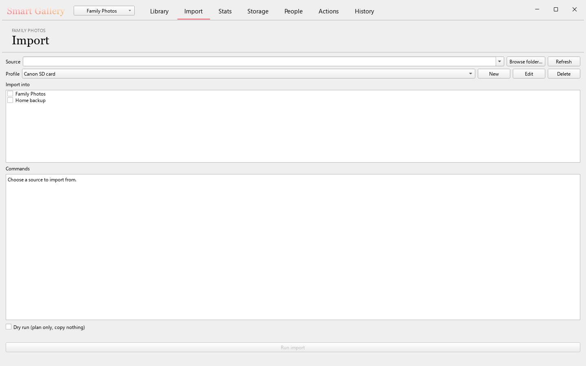

1. **Source.** Removable drives (SD cards, USB sticks) appear in the list;
   press **Refresh** after inserting a card, or **Browse folder…** for any
   other folder.
2. **Profile.** A profile says what to copy and where. Two are provided:
   *Canon SD card* and *Pixel dump*. **New**, **Edit** and **Delete** manage
   them.
3. **Import into.** Tick each gallery to copy into.
4. The **Commands** box shows exactly what will run.
5. Tick **Dry run** to see what would be copied without copying anything.
6. Press **Run import**.

#### Profiles and rules

A profile is a list of **rules**. Each rule picks one file type and some
extensions, and says where they go:

| Rule setting | Example | Meaning |
|---|---|---|
| File type | Photos | Photos or videos. |
| Extensions | `.cr3 .jpg` | Which files this rule takes. |
| Output folder | `Photos/Canon` | Folder inside the gallery. |
| Folder structure | Year, Month | Subfolders to create, in order: `Photos/Canon/2026/10/`. Year, Month, camera Model and Lens are available. |
| On a name clash | Skip | *Skip* leaves the existing file alone; *Rename* adds `_1`, `_2`… to the new one. |

The starter *Canon SD card* profile copies `.cr3` and `.jpg` photos to
`Photos/Canon/<year>/<month>/` and `.mp4` videos to `Videos/<year>/<month>/`,
skipping names that already exist.

**Only the new files are read.** Import reads the information of the files it
copies, not the whole drive, so it is quick even on a large gallery.

If the gallery has a mirror drive, the import also copies each file to the
mirror ([section 12](#12-two-drives-a-working-copy-and-a-mirror)).

### Export

Export copies a selection of the open gallery **to** a folder: a USB stick, a
folder to share, a disk for a print shop. It only reads the gallery; nothing
in it changes, and the copies are not added to the catalog.

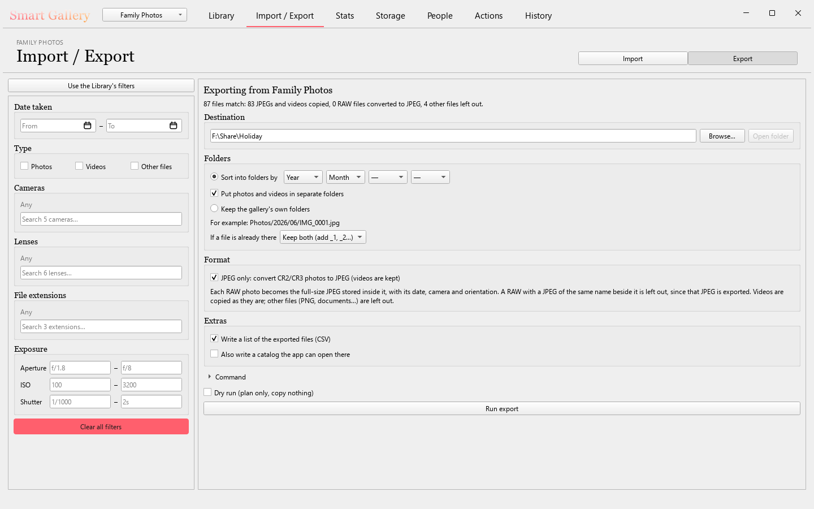

1. **Filters (left).** The same filters as the Library: dates, photos or
   videos, cameras, lenses, extensions, exposure and, once face recognition has
   run, **People**. They are the Export page's own: changing them doesn't
   change the Library, and the other way round. **Use the Library's filters**
   copies in what the Library shows right now. The line under the title says
   how many files match.
2. **Destination.** The folder to copy into; **Browse…** picks one and
   **Open folder** shows it in File Explorer. Each export goes into a new
   folder inside it, named in **Folder name**. Left empty, it is
   `Export <date> <time>` (for example `Export 20261028 2217`), dated when you
   press **Run export**; type any other name instead. The name is not kept
   for the next export.
3. **Folders.** Either **Sort into folders by** up to four levels (Year, Month,
   Camera, Lens, in the order you pick) or **Keep the gallery's own folders**.
   **Put photos and videos in separate folders** adds `Photos/` and `Videos/`
   on top. The *For example* line shows where a photo would land. **If a file
   is already there**, *Keep both* adds `_1`, `_2`… to the new copy and *Skip
   it* leaves the existing file alone (handy to finish an export that was
   stopped: type that export's folder name again).
4. **Format.** **JPEG only** makes every photo in the export a JPEG, for
   sharing:
   - JPEG files and videos are copied as they are.
   - Canon RAW files (`.cr2`, `.cr3`) are converted: each becomes the
     full-size JPEG stored inside it, with its date, camera, lens and
     orientation, the same as **convert-raw** makes. The RAW files on the
     gallery are not touched.
   - A RAW with a JPEG of the same name in the same folder (a RAW + JPEG pair)
     is not converted; that JPEG is exported instead.
   - Other files (PNGs, documents…) are left out. Untick **Videos** in the
     filters if you don't want the videos either.

   The summary line then says how many files are copied, converted and left
   out. This option needs ExifTool.
5. **Extras.** A list of the exported files
   (`_smart_gallery_manifest.csv`, on by default), and optionally a catalog of
   the export itself, so the folder can be opened as a gallery.
6. Tick **Dry run** to plan without copying, then press **Run export**. If
   something is missing (a destination, say), a line above the button says
   what. Click **Command** to unfold the exact command that will run.

The page remembers your destination and choices for next time.

---

## 8. Keeping the catalog up to date

The catalog notices changes made **through Smart Gallery** automatically. If
you add, delete, rename or edit files **outside** the app (in File Explorer,
in a photo editor, from another program), run a **sync** so the catalog
catches up:

- In the app: **Actions** page, choose **sync**, press **Run**.
- From a command prompt: `smart-gallery sync E:\`

Sync is quick: it compares each file's size and modification time with the
catalog, reads only new or changed files, and removes entries for files that
are gone. Its summary looks like `+12 ~3 -5 =40100`: 12 added, 3 updated,
5 removed, 40,100 unchanged.

If face recognition is set up, sync also tells you how many new images are
waiting for a face scan.

---

## 9. Stats

The **Stats** page draws charts of the open gallery, using the same filters as
the Library:

- tiles with totals (total files, images, videos, total size, video length),
- **Cameras and Lenses**: which cameras and lenses you use most,
- **Camera Settings Distribution**: apertures, ISO, shutter speeds, focal lengths,
- **Photography Timeline**: photos per month,
- **Video Recording Summary**,
- **Photo Map**: where geotagged photos were taken.

Click a panel's title to fold it; the app remembers which panels you folded.

<!-- SCREENSHOT TO ADD: images/area-stats.png — the Stats page with charts and the photo map. -->
> *Screenshot to add: the Stats page.*

---

## 10. Storage: where the space goes

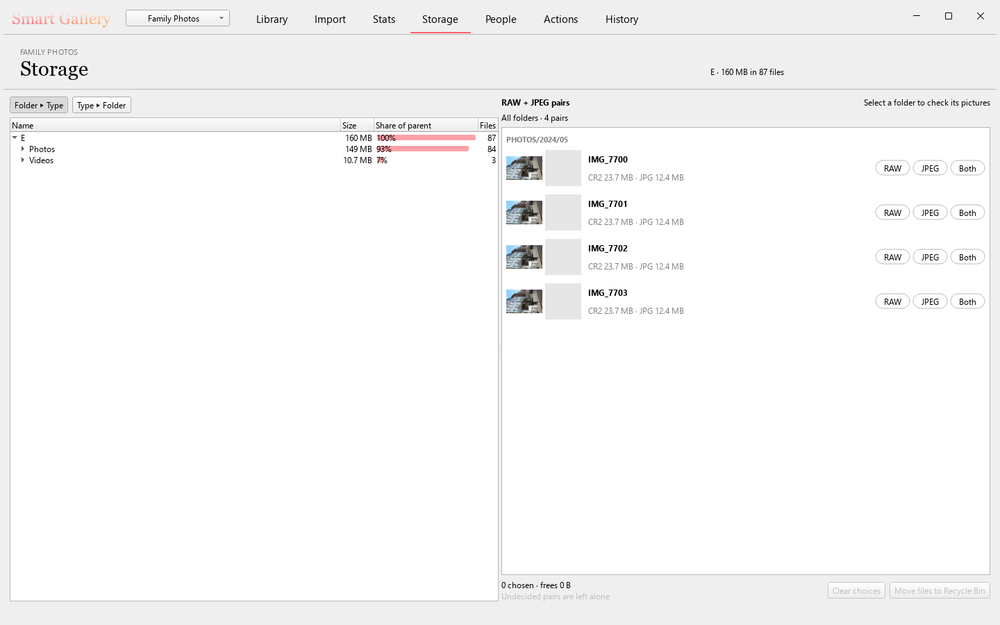

**Left: the size tree.** Every folder with its size, its share of the folder
above it (the bar), and its number of files. **Folder ▸ Type** groups by
folder, then by file type; **Type ▸ Folder** groups by type first ("how much
space do my videos take, and where?").

**Right: RAW + JPEG pairs.** Many cameras save each shot twice, as a RAW file
(`.CR2`, `.CR3`) and a JPEG with the same name. The list shows each pair with
both previews and sizes. For each pair choose **RAW** (keep only the RAW),
**JPEG** (keep only the JPEG) or **Both**. Pairs you don't decide are left
alone.

- Click a folder on the left to show only its pairs. **Select a folder to
  check its pictures**: the app compares the two images of each pair in that
  folder and remembers the result.
- The footer adds up your choices (*3 chosen · frees 72 MB*).
- **Move files to Recycle Bin** moves the files you chose not to keep to the
  Windows Recycle Bin and removes them from the catalog. **Clear choices**
  starts over.

Nothing is deleted outright. If the drive has no Recycle Bin (for example a
removable drive), the app refuses before touching anything. A file whose size
or date changed since you chose is skipped. To undo, restore the files from
the Recycle Bin and run a [sync](#8-keeping-the-catalog-up-to-date).

---

## 11. People: finding photos by who is in them

Face recognition finds the faces in your photos, groups similar faces, and
lets you name the groups. Then you can filter the Library by person.

### Setting it up (once)

Face recognition is an optional add-on that needs an NVIDIA graphics card.
The installer includes it when it was built with it. From source:

```bash
uv sync --extra faces --extra gui
```

Without it, the People page says *Face recognition is not installed*. The
[face recognition guide](../FACES.md) covers the GPU requirements and how to
check that the graphics card is used.

<!-- SCREENSHOT TO ADD: images/area-people.png — the People page with named people, a person's photos, and the Faces view. -->
> *Screenshot to add: the People page with people found.*

### The workflow

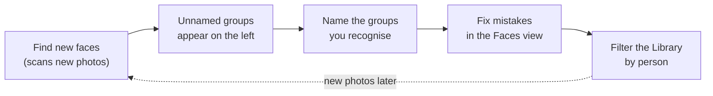

1. **Find new faces.** The header shows how many images are not scanned yet.
   Press **Find new faces**. The first scan of a large gallery takes a while
   (roughly 15–40 minutes for 90,000 photos); later runs only scan new photos.
2. **Name the groups.** The left column lists named people and unnamed groups
   the program found. Select a group, then **Add a name**. If you type a name
   another person already has, the app offers to merge the group into them. **Hide group** puts
   away groups of strangers; **Hidden groups** shows them again.
3. **Fix mistakes.** On a person's page, **Photos** shows their photos and
   **Faces** shows every face, least sure first. Select faces (tick boxes) and
   confirm them, **Move to…** another person, **New person…**, or say
   **Not this group**. The suggestions strip offers close matches to accept
   or reject. Your corrections are sent as one job when you leave the page,
   and the remaining faces are sorted again so the suggestions improve.
   **Find more** (beside **Show in Library**) searches the faces nobody has
   sorted yet for ones that look like this person, best match first; confirm
   or reject them like suggestions. **Undo** (or Ctrl+Z) reverses the last
   batch of face corrections. Undo refuses, changing nothing, once Find new
   faces, a merge or a rescan has changed those faces; the message then offers
   **Forget this undo step**, after which older steps can be undone.
4. **Whole groups.** **Merge people** joins several into one, **Split group**
   separates a group that mixes two people, **Delete person** returns its
   faces to the pool.
5. **Filter by person.** **Show in Library** opens the Library filtered to the
   selected people. With several selected, choose **Any of them** or **All of
   them**.

Your own decisions are never undone by the program: a face you confirmed or
ignored stays that way, and "not this person" is remembered. If a photo is
edited and scanned again, your decisions carry over to the new scan. The
[face recognition guide](../FACES.md) explains the face states and tuning.

> **With a mirror drive,** scan faces on the working drive only. The mirror
> receives a copy of the face data at each sync, and face commands refuse to
> run on a mirror.

---

## 12. Two drives: a working copy and a mirror

If you keep the same library on two drives (for example a fast external drive
you work on, and a local drive as the safe copy), Smart Gallery can keep them
identical. One drive is the **working drive**; the other is its **mirror**.
Changes flow one way only, from the working drive to the mirror.

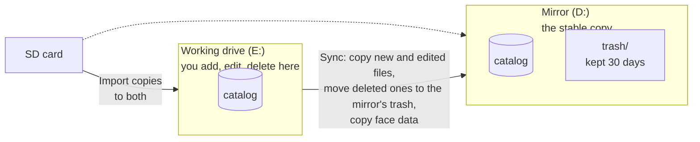

What a sync does and does not do:

- New and edited files on the working drive are copied to the mirror.
- Files you deleted or renamed on the working drive are deleted or renamed on
  the mirror too. A deleted file goes to the **mirror's trash** folder, not
  away, and stays there for 30 days.
- Face data is copied to the mirror, so face recognition runs only once.
- Changes made **outside the app** (in File Explorer) are noticed too.
- Nothing on the mirror is deleted outright, and nothing happens without a
  **preview** you confirm first.

All mirror actions are in the **Mirror** button in the Library header.

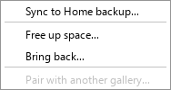

### Step 1: pair the drives (once)

Both drives need a gallery first (create one on each, see
[section 5](#5-galleries)). Open the **working** gallery, then
**Mirror ▸ Pair with another gallery…**, and pick the gallery that becomes its
mirror.

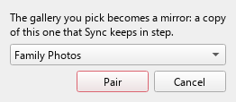

Drives are recognised by their catalog, not their letter, so a drive that
comes back as `F:` instead of `D:` still pairs. A working drive can have
several mirrors; each gets its own *Sync to…* entry.

On the mirror gallery, the Mirror menu only says to open the working drive to
sync.

### Step 2: sync

Choose **Mirror ▸ Sync to *mirror name*…**. The app compares the two drives
(this first comparison can be slow; later ones are quick) and shows a preview.

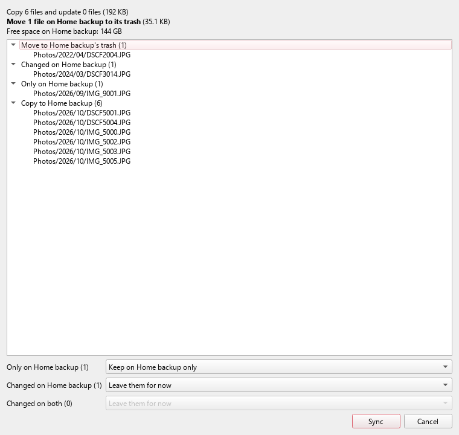

The top lines summarise what will happen: how many files are copied, how many
are moved to the mirror's trash (in bold, with their size), and the free space
on the mirror. Open each group to see its files. Then decide what to do with
the cases only you can judge:

| Group | What it means | Your choices |
|---|---|---|
| **Only on *mirror*** | Files on the mirror that the working drive never had. | *Keep on mirror only* (they appear greyed out on the working drive and you're not asked again), *Copy back to this drive*, or *Decide later*. |
| **Changed on *mirror*** | Edited on the mirror only, or deleted on the working drive but edited on the mirror. | *Leave them for now*, *Overwrite with this drive's version* (the mirror's copy goes to its trash; for a file you deleted, the deletion wins), or *Keep ‹mirror›'s version* (copied back to the working drive). |
| **Changed on both** | Edited on both drives since the last sync. | *Leave them for now*, *Keep this drive's version*, or *Keep ‹mirror›'s version*. |
| **Different file at a freed-up path** | A new file sits where a freed-up photo used to be. | Nothing is done; move the new file elsewhere so it can be synced. |
| **Kept only on *mirror*, changed there** | A freed-up photo was edited on the mirror. | Shown for information; nothing is done. |
| **Kept only on *mirror*, now missing** | A freed-up photo is gone from the mirror, which held the only copy. | Shown as a warning; nothing is done. Look for the file in the mirror's trash or another backup. |

Press **Sync** to apply. The app applies **exactly** what the preview
showed. If the drives changed while the preview was open, it stops without
doing anything, and you start again.

If a sync would move more than 5% of the mirror's files to its trash, a
checkbox asks you to confirm. That usually means a drive was mounted wrongly,
or a large folder was deleted by mistake. The sync also refuses to run when
either drive is missing or does not match the pairing.

### Freeing up space on the working drive

When the working drive fills up, you can keep older photos on the mirror only:
**Mirror ▸ Free up space…**.

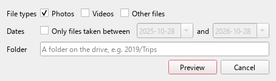

1. Choose what to free: file types, a date range (*Only files taken between*),
   and/or a folder.
2. **Preview** shows how many files would be freed and how much space, and
   which files are skipped and why.
3. Confirm. Each file is deleted from the working drive only after the app has
   read both copies and found them identical, and, for photos, after their
   faces have been scanned and copied to the mirror.

Freed-up photos stay in the Library, greyed out. Future imports matching the
same choice (for example "videos") go to the mirror only.

### Bringing files back

**Mirror ▸ Bring back…** copies freed-up files from the mirror back to the
working drive (same choices: types, dates, folder). They are no longer greyed
out.

### Importing with a mirror

Imports copy each new file to the working drive and then to every mirror
that is plugged in. If a mirror is not connected, the import still finishes
and the next sync copies the files across.

### Good habits

- Make changes on the working drive, not on the mirror. Sync only ever copies
  from the working drive, so a file you delete on the mirror alone comes back:
  the next sync copies it from the working drive again. To delete a file from
  both drives, delete it on the working drive and sync.
- Sync after each import or editing session.
- To get a freed-up photo back, use **Bring back**. Copying it back by hand
  from the mirror also works, as long as the copy keeps its date (File
  Explorer does). Any other file at a freed-up photo's path (same folder and
  file name) is shown in the preview as *Different file at a freed-up path*
  and left alone; move it elsewhere to have it synced.
- The mirror's trash is `.smart_gallery\trash\` on the mirror drive, one folder
  per sync, named by date and time, with the files under their original folder
  paths. To undo a deletion, copy the file from there back to the **working
  drive** (same folder as before), then sync: the mirror gets its copy again.
  Copying it back to the mirror alone doesn't undo it; the next preview lists
  it as **Only on *mirror***.
- Trash folders older than 30 days are removed at the end of a sync, so
  nothing is cleaned up between syncs. If you haven't synced for two months,
  the old trash is still there until the next sync finishes.

---

## 13. Actions and History: jobs

### Actions

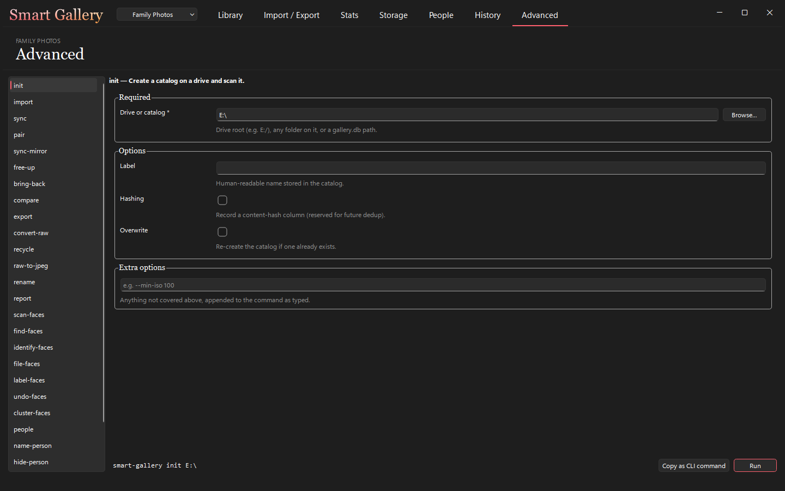

The **Actions** page offers every Smart Gallery command as a form: pick a
command on the left, fill in its options, press **Run**. Required fields are
marked with `*`, each option has a short explanation under it, and the line at
the bottom shows the exact command that will run. **Copy as CLI command**
copies it so you can run it from a command prompt.

The drive field starts at the open gallery. Commands you will most often run
from here:

| Command | Use it to |
|---|---|
| **sync** | Update the catalog after changes made outside the app. |
| **export** | The same as the Export page ([section 7](#export)), for scripting or the command line. |
| **report** | Write an Excel workbook listing the files (optionally with charts). |
| **compare** | Compare two catalogs. |
| **convert-raw** | Extract the full-size JPEG stored inside Canon RAW files. |
| **rename** | Rename a gallery. |

### History

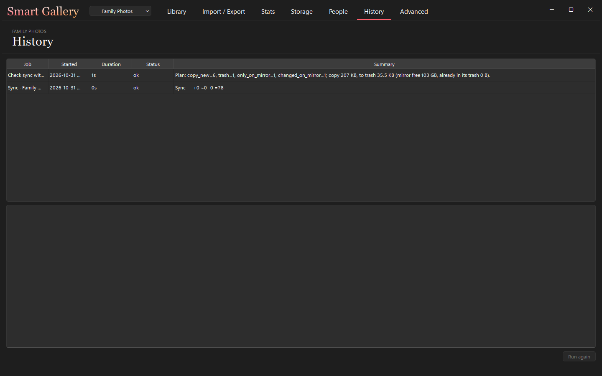

**History** lists every job the app ran, newest first: its title, when it
started, how long it took, how it ended (*ok*, *failed*, *cancelled*) and a
one-line summary. Select a job to read the end of its log below. **Run again**
repeats it with the same options.

---

## 14. The command line

Everything the app does is also available as a command, which is handy for
scripts or remote use. The app's [Actions page](#13-actions-and-history-jobs)
shows the command for any form.

```bash
smart-gallery <command> [options]
smart-gallery <command> --help     # every option of one command
```

| Command | What it does |
|---|---|
| `init <drive>` | Create a catalog on a drive and scan it. |
| `import <sources…> --to <drive>` | Copy media in and update the catalog. |
| `sync <drive>` | Reconcile the catalog with the files on the drive. |
| `pair`, `sync-mirror`, `free-up`, `bring-back` | Keep a working drive and a mirror in step. |
| `export --from <drive> --to <dir>` | Copy a filtered selection elsewhere. |
| `report <drive> --to <file.xlsx>` | Excel report. |
| `compare <a> <b>` | Compare two catalogs. |
| `recycle <drive> --list <file>` | Move listed files to the Recycle Bin. |
| `rename <drive> "<name>"` | Rename a gallery. |
| `convert-raw <sources…>` | Extract JPEG previews from Canon RAW files. |
| `find-faces`, `label-faces`, `people`, `name-person`, … | Face recognition. |
| `gui` | Open the desktop app. |
| `ui` | A text-based menu in the terminal. |
| `dashboard <drive>` | A browser dashboard (from source installs). |

Filters work the same as in the app, for example
`--file-types image --date-start 2024-01-01 --cameras "Canon EOS R6"`.

The [README](../README.md#cli-guide) documents every command and option, and
the [face recognition guide](../FACES.md) the face commands.

---

## 15. Where your data lives

| What | Where |
|---|---|
| A gallery's catalog | `<drive>\.smart_gallery\gallery.db` |
| Thumbnails and face crops of a gallery | `<drive>\.smart_gallery\thumbs\`, `…\faces\` |
| A mirror's trash (30 days) | `<mirror drive>\.smart_gallery\trash\<date-time>\` |
| App settings: known galleries, job history, import profiles, layout | `%LOCALAPPDATA%\SmartGallery\` |
| Detailed log of each long command run from a terminal | `logs\<command>-<date>_<time>.log` in the folder you ran it from |
| Face recognition models | `%USERPROFILE%\.insightface\models\` |

Back up your **drives** as you normally would; the `.smart_gallery` folder is
part of the drive and is copied with it. The app settings folder can be
recreated (re-add your galleries with **Add existing…**).

---

## 16. Troubleshooting and questions

**A yellow bar says ExifTool was not found.**
Install [ExifTool](https://exiftool.org/) and make sure `exiftool` runs from a
command prompt, then restart the app.

**My gallery shows "Drive not connected".**
Plug the drive in and choose **Refresh drives** in the gallery menu. A new
drive letter is fine.

**I deleted or edited files in File Explorer and the Library still shows the
old state.**
Run **sync** from the Actions page ([section 8](#8-keeping-the-catalog-up-to-date)).

**Thumbnails show a grey picture.**
They are being made; give it a moment. A file the program cannot read (an
unusual format, a damaged file) keeps the grey placeholder.

**An import copied nothing.**
Check the **Commands** box: the profile's extensions must match your files
(for example `.cr3` for Canon RAW). With *On a name clash: Skip*, files whose
names already exist in the target folder are skipped. Run with **Dry run** to
see what would happen.

**"A job is already running."**
Only one job runs at a time. Wait for it, or press **Cancel** in the status bar.

**The People page says face recognition is not installed.**
See [section 11](#11-people-finding-photos-by-who-is-in-them). The app works
fully without it.

**A mirror sync refused to run.**
It refuses when a drive is missing, its catalog doesn't match the pairing, or
the working drive looks empty. These protect the mirror from a wrongly mounted
drive. Check both drives are plugged in and are the right ones.

**A sync wants to trash many files and asks me to confirm.**
Stop and check. Usually a drive was mounted under the wrong letter, or a
folder was deleted by mistake. Cancel unless you really meant it.

**How do I undo a mirror sync's deletion?**
Copy the file back from `<mirror>\.smart_gallery\trash\<date-time>\…` (kept
30 days) to the same folder on the working drive, then sync again. Don't copy
it back to the mirror only: the sync would then list it as **Only on *mirror***.

**I deleted a file on the mirror and the next sync copied it back.**
That is expected: sync goes one way, from the working drive to the mirror, and
a file missing from the mirror is simply copied again. Delete files on the
working drive instead; the sync then moves the mirror's copy to its trash.

**How do I undo "Move files to Recycle Bin" on the Storage page?**
Restore the files from the Windows Recycle Bin, then run **sync**.

**Can I use the same drive on two computers?**
Yes. The catalog is on the drive; on the other computer use **Add
existing…**.

---

## 17. Glossary

| Term | Meaning |
|---|---|
| **Gallery** | A drive or folder managed by Smart Gallery. |
| **Catalog** | The database (`.smart_gallery\gallery.db`) that describes every file in a gallery. |
| **Job** | A background task (import, sync, scan…) shown in the status bar and on the History page. |
| **Profile** | A saved import recipe: which files to copy and where. |
| **Rule** | One line of a profile: a file type, its extensions, and its target folder. |
| **Sync** | Updating a catalog with changes on its drive, or (*mirror sync*) copying changes from the working drive to its mirror. |
| **Working drive** | The drive you work on; changes flow from it to its mirrors. |
| **Mirror** | A drive kept as an identical copy of a working drive. |
| **Pairing** | The link between a working drive and a mirror. |
| **Free up / offloaded** | Deleting files from the working drive while the mirror keeps them; shown greyed out. |
| **Bring back** | Copying freed-up files from the mirror back to the working drive. |
| **Trash** | The mirror's folder where deleted and replaced files are kept for 30 days. |
| **RAW + JPEG pair** | The same shot saved twice by the camera, as RAW and as JPEG. |
| **Dry run / preview** | Showing what would happen without doing it. |
| **Face group / person** | Faces the program grouped as one person; a group becomes a person when you name it. |
